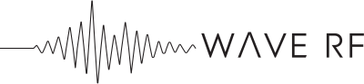

  <a href="https://wave-rf.com/?utm_source=github&amp;utm_medium=referral&amp;utm_campaign=org-profile&amp;utm_content=header-logo"><picture><source media="(prefers-color-scheme: dark)" srcset="assets/logo-dark.svg"></picture></a>

  <strong>Connectivity and real-time data infrastructure.</strong>
   
  We build both ends: resilient multi-modal connectivity that gets data off remote&nbsp;devices,
   
  and the open-source data layer that makes it queryable the moment it lands.

  <a href="https://wave-rf.com/?utm_source=github&amp;utm_medium=referral&amp;utm_campaign=org-profile&amp;utm_content=header">wave-rf.com</a> ·
  <a href="https://wavehouse.dev/?utm_source=github&amp;utm_medium=referral&amp;utm_campaign=org-profile&amp;utm_content=header">wavehouse.dev</a> ·
  <a href="https://wavehouse.cloud/?utm_source=github&amp;utm_medium=referral&amp;utm_campaign=org-profile&amp;utm_content=header">wavehouse.cloud</a>

## Open source

### Data infrastructure

- [**WaveHouse**](https://github.com/Wave-RF/WaveHouse): ClickHouse® is a great database with a subpar API; WaveHouse fixes that. One binary for durable ingest, a query cache, real-time SSE push, and row- and column-level security, with ClickHouse as its only external dependency. Alpha. [Quick start](https://wavehouse.dev/getting-started?utm_source=github&utm_medium=referral&utm_campaign=org-profile&utm_content=wavehouse-quickstart) · [Docs](https://wavehouse.dev/?utm_source=github&utm_medium=referral&utm_campaign=org-profile&utm_content=wavehouse-docs) · [See it running](https://stats.wavehouse.dev/?utm_source=github&utm_medium=referral&utm_campaign=org-profile&utm_content=wavehouse-stats)
- [**chtypes**](https://github.com/Wave-RF/chtypes): ClickHouse®'s own type system, as a library you can call from Go, Python, TypeScript, and Rust. For any row, schema, and ClickHouse version it says whether the row is accepted, rejected, or poisoned, and the exact value that would be stored. [Quickstart](https://github.com/Wave-RF/chtypes/blob/main/docs/quickstart.md)

### For Astro and Starlight sites

- [**starlight-llm-tools**](https://github.com/Wave-RF/starlight-llm-tools): per-page `.md` twins, `llms.txt`, and Copy-Markdown / Open-with-AI buttons
- [**astro-themed-mermaid**](https://github.com/Wave-RF/astro-themed-mermaid): build-time, theme-aware Mermaid diagrams for Astro and Starlight
- [**astro-trademarks**](https://github.com/Wave-RF/astro-trademarks): marks the first mention of each trademark on a page with ® or ™, and renders that page's trademark notices
- [**starlight-glossary**](https://github.com/Wave-RF/starlight-glossary): interactive glossary with hover tooltips for Starlight docs

### For Cloudflare Workers

- [**cloudflare-md-router**](https://github.com/Wave-RF/cloudflare-md-router): a Worker that serves Markdown twins to LLM crawlers and HTML to everyone else
- [**cloudflare-preview**](https://github.com/Wave-RF/cloudflare-preview): GitHub Actions for Worker preview deploys built in CI, with per-PR preview URLs, a sticky PR comment, and GitHub Deployments
- [**serverless-registry**](https://github.com/Wave-RF/serverless-registry): our fork of Cloudflare's container registry on Workers and R2, carrying fixes not yet merged upstream plus anonymous pulls, immutable release tags, an append-only mode, and the OCI conformance suite in CI

## WaveHouse Cloud

> [!TIP]
> **Rather not run it yourself?** [**WaveHouse Cloud**](https://wavehouse.cloud/?utm_source=github&utm_medium=referral&utm_campaign=org-profile&utm_content=cloud-cta) is managed WaveHouse and ClickHouse with zero ops: stream events in, and publish secure, cached REST and SSE APIs on infrastructure that starts tiny and scales with your traffic. Start on the free plan, and pay for what you use as you grow.
>
> **[Sign up free →](https://console.wavehouse.cloud/?utm_source=github&utm_medium=referral&utm_campaign=org-profile&utm_content=cloud-signup)** &nbsp;·&nbsp; or [run WaveHouse yourself](https://wavehouse.dev/getting-started?utm_source=github&utm_medium=referral&utm_campaign=org-profile&utm_content=cloud-self-host), free and open source
